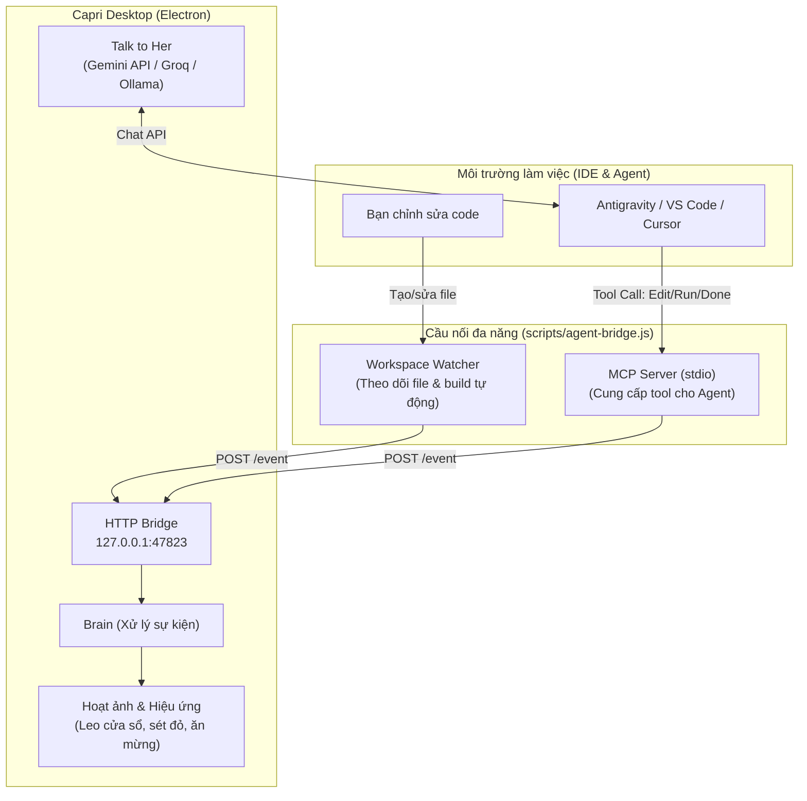

# Hướng Dẫn Sử Dụng Capri Với Antigravity & AI Agents Miễn Phí

Dự án này đã được tối ưu hóa để bạn có thể sử dụng trọn vẹn mọi hiệu ứng đồ họa, âm thanh, và hoạt ảnh của cô nàng Desktop Pet **Capri** mà **hoàn toàn không cần tài khoản Claude Code trả phí**.

---

## 1. Kiến trúc hệ thống (System Architecture)



---

## 2. Các phương thức kích hoạt Capri

### Cách 1: Tự động 100% bằng Workspace Watcher (Khuyên dùng)
Bạn không cần cấu hình gì trong IDE. Chỉ cần bật watcher, mọi thao tác tạo/sửa file của bạn hoặc của Antigravity sẽ tự động kích hoạt Capri:
```bash
# Theo dõi thư mục dự án hiện tại:
npm run bridge

# Hoặc theo dõi một thư mục bất kỳ:
npm run bridge -- --watch "D:/my-awesome-project"
```
- Khi bắt đầu sửa file: Capri bay đến ngồi lên mép trên cửa sổ IDE.
- Khi lưu/sửa file: Ticker hiện `EDITS filename.ext`, Capri phát xung nhịp.
- Khi chạy build/test sinh ra file output: Capri hiện `RUNS build...` và phóng tia sét đỏ (`spark` & `possess`).
- Khi dừng thao tác 4.5s: Capri teleport ra giữa màn hình và làm động tác chiến thắng ăn mừng!

---

### Cách 2: Tích hợp qua MCP (Model Context Protocol)
Antigravity đã được tự động kết nối qua tệp `~/.gemini/config/mcp_config.json`:
```json
{
  "mcpServers": {
    "capri": {
      "command": "node",
      "args": [
        "C:/Users/nguye/.gemini/antigravity/scratch/capri-project/capri-desktop-main/scripts/agent-bridge.js",
        "--mcp"
      ]
    }
  }
}
```
Các tool được cung cấp:
- `capri_start`: Báo bắt đầu task mới với nội dung prompt.
- `capri_thinking`: Báo Agent đang suy nghĩ (Capri đếm giây).
- `capri_tool_use`: Báo công cụ đang chạy (`Read`, `Edit`, `Bash`...).
- `capri_permission`: Báo cần người dùng duyệt quyền (Capri chỉ tay vào cửa sổ).
- `capri_done`: Báo hoàn thành công việc (Capri làm động tác chiến thắng).
- `capri_error`: Báo lỗi lệnh (Capri giật mình bị thương).
- `capri_say`: Hiện câu thoại bất kỳ trên bong bóng chat của Capri.

---

### Cách 3: Chạy kịch bản kiểm thử nhanh
Để kiểm tra mọi phản ứng của Capri ngay lập tức mà không cần gõ code:
1. Mở Capri: `npm start`
2. Mở một terminal khác và chạy:
```bash
npm run test:agent
```
Capri sẽ lần lượt diễn chuỗi: Chào hỏi -> Đậu lên cửa sổ -> Báo sửa file -> Phóng sét đỏ khi chạy test -> Chỉ tay khi cần cấp quyền -> Teleport ra sân khấu ăn mừng chiến thắng!

---

## 3. Cấu hình tính năng "Talk to her" (Nói chuyện với Capri)

Bạn có thể trò chuyện miễn phí với Capri bằng các dịch vụ AI miễn phí:

1. Sao chép file `.env.example` thành `.env`:
   ```bash
   cp .env.example .env
   ```
2. Điền API Key của bạn vào `.env`:
   - **Google Gemini API (Miễn phí):** Lấy key tại [Google AI Studio](https://aistudio.google.com/apikey)
     ```ini
     AI_BASE_URL=https://generativelanguage.googleapis.com/v1beta/openai
     AI_API_KEY=AIzaSy...
     AI_MODEL=gemini-2.0-flash
     ```
   - **Groq API (Miễn phí, cực nhanh):** Lấy key tại [Groq Console](https://console.groq.com)
     ```ini
     AI_BASE_URL=https://api.groq.com/openai/v1
     AI_API_KEY=gsk_...
     AI_MODEL=llama-3.3-70b-versatile
     ```
   - **Ollama Local:** Không cần điền gì vào `.env`, Capri sẽ tự động kết nối `127.0.0.1:11434`.
